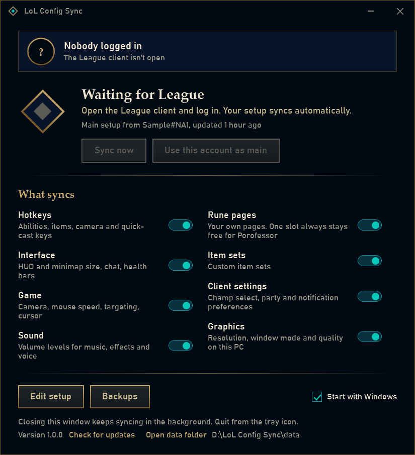
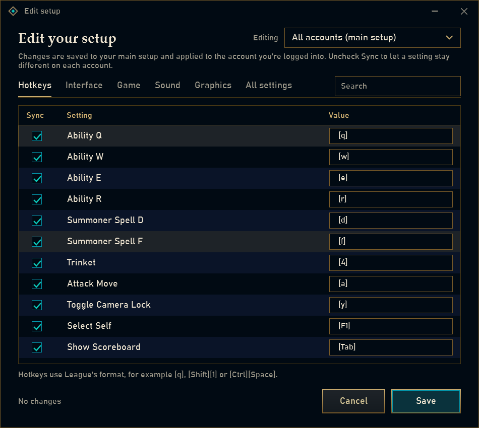
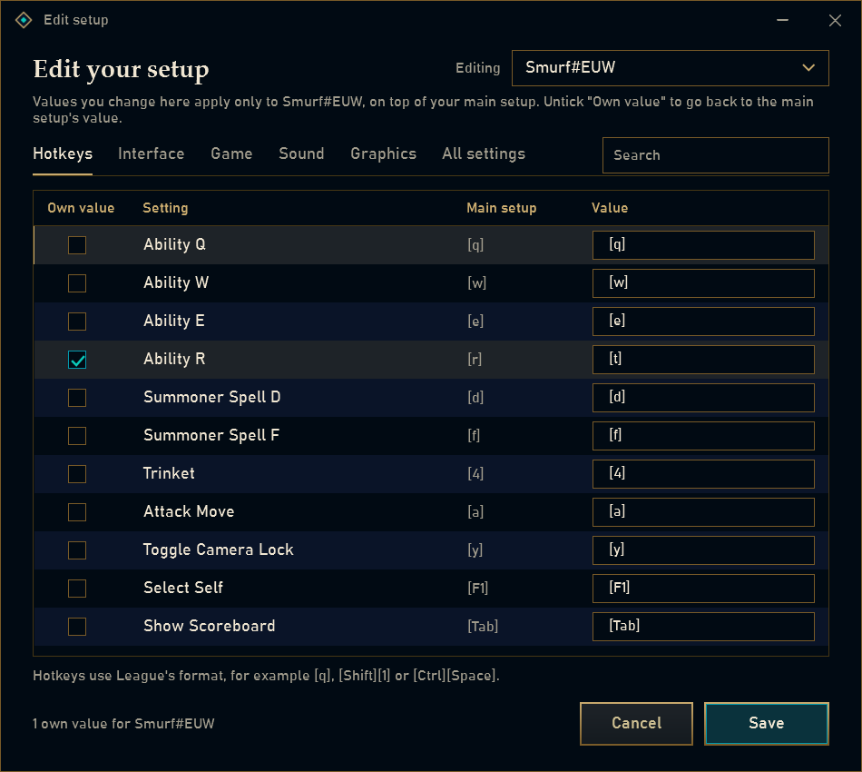
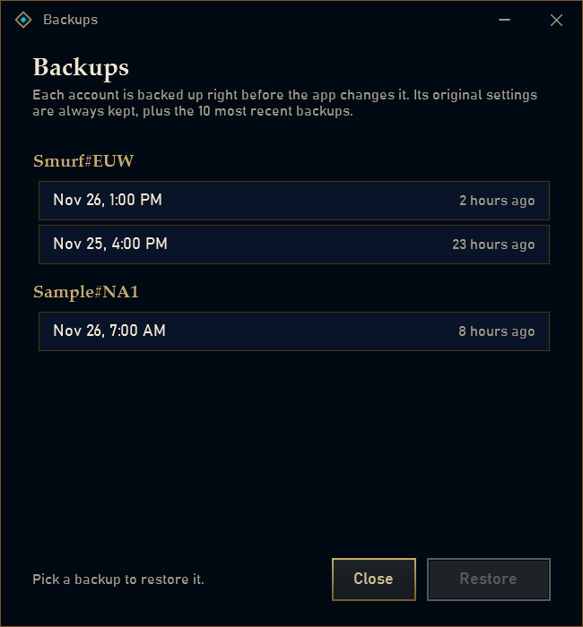

# LoL Config Sync

**Every League of Legends account, same settings.** If you switch accounts a lot, LoL Config Sync keeps your hotkeys, interface, camera, sound, rune pages and more identical on all of them, automatically.

[](https://github.com/dexterpena/lol-config-sync/actions/workflows/ci.yml)
[](https://github.com/dexterpena/lol-config-sync/releases/latest)
[](LICENSE)



## Why

Riot stores your settings online, per account. Log into a different account and you get that account's keybinds, HUD scale and camera, not yours. Making `PersistedSettings.json` read-only, the usual workaround, stops League from saving anything at all.

LoL Config Sync works with the client instead of against it. It keeps one **main setup**, applies it to whichever account you log into, and saves changes you make in-game back into the main setup, so every account stays in step.

## Features

- **Automatic sync:** log into any account and your setup is applied once you're out of a game. A notification confirms it.
- **Changes flow back:** change a hotkey or your HUD on any account and the app saves it, so the next account gets it too.
- **Everything that matters:** hotkeys, interface, game and camera settings, sound, rune pages, item sets, client preferences (champ select, party, notifications) and graphics.
- **You choose what syncs:** a toggle per group, plus "don't sync" on any single setting.
- **Per-account values:** give one account its own value for any setting (say, different keybinds on a smurf). It's applied on top of the main setup.
- **Porofessor-friendly:** one rune page slot always stays free for Porofessor, and its pages never spread to your other accounts.
- **Backups first:** before changing an account, the app backs it up under its Riot ID. Each account's original settings are kept forever, and you can restore with one click.
- **Shows who's logged in:** Riot ID, level and profile icon.
- **Updates itself** from GitHub releases.
- **Installer or portable:** the data lives next to the app.

## Download

Get the latest version from **[Releases](https://github.com/dexterpena/lol-config-sync/releases/latest)**. Neither download needs .NET installed.

| Download | What it does |
|----------|--------------|
| `LolConfigSync-Setup-x.y.z.exe` (recommended) | Installs for your Windows user (no admin prompt) to `%LOCALAPPDATA%\Programs\LoL Config Sync`, adds a Start menu shortcut, and appears in Installed apps for uninstalling. |
| `LolConfigSync-x.y.z-portable.zip` | Extract it anywhere (a games folder, a USB stick). Run `LolConfigSync.exe` inside the `LoL Config Sync` folder. Its data stays in that folder. |

Windows may show a SmartScreen warning the first time because the app isn't code-signed. Choose **More info**, then **Run anyway**.

## How to use it

1. Start LoL Config Sync, then open the League client and log into the account whose settings you like best.
2. When asked, choose **Use as main**. That account's settings become your main setup.
3. That's it. Log into your other accounts and they get the same setup. The app lives in the tray. Closing the window keeps it running, and you quit from the tray icon.

### What syncs

Use the toggles in the main window to choose:

| Toggle | Covers |
|--------|--------|
| Hotkeys | Abilities, items, camera and quick-cast keys |
| Interface | HUD and minimap size, chat, health bars |
| Game | Camera, mouse speed, targeting, cursor |
| Sound | Volume levels |
| Rune pages | Your own rune pages (one slot always left free for Porofessor) |
| Item sets | Custom item sets |
| Client settings | Champ select, party and notification preferences |
| Graphics | Resolution, window mode and quality. These are per-PC, not per-account, so this just keeps them pinned. |

### Editing settings

**Edit setup** shows every setting with friendly names, grouped like the in-game Settings menu.

- Change any value, or untick **Sync** to let a setting stay different on each account.
- Switch **Editing** to a specific account to give it **its own values**. They're applied on top of the main setup whenever you log into that account. Changing them in-game on that account updates that account's value, not the main setup.

| Main setup | One account's own values |
|---|---|
|  |  |

### Backups

Before the app changes anything on an account, it saves that account's current settings in `data\backups\<Riot ID>\`. If the backup can't be saved, nothing is changed. Each account keeps its **original settings** (from before its first sync) forever, plus its 10 most recent backups. Restore one from **Backups** while logged into that account.



### Porofessor

One rune page slot on every account is always left empty so Porofessor can create its page in champ select. Pages named `Porofessor: …` (anything starting with `Porofessor` or `Poro`) are never synced. If one is in the free slot when a sync needs to rewrite your pages, it's cleared, and Porofessor makes a new one next champ select. Both are adjustable in `settings.json` (`ReservedRunePageSlots`, `ToolRunePagePrefixes`).

### Updates

The app checks for a new version once a day. You can also click **Check for updates** at the bottom of the main window. When there is one, you'll see what's new and an **Update now** button. The app downloads it, verifies it, and restarts on the new version. Your setup, settings and backups are kept.

## Where your data lives

In a `data` folder next to `LolConfigSync.exe`, so moving or copying the app folder takes your setup with it. If the app is somewhere Windows won't let it write (like `Program Files`), it uses `%APPDATA%\LolConfigSync` instead. **Open data folder** at the bottom of the main window takes you there.

| File | What it is |
|------|------------|
| `main-setup.json` | Your main setup (previous version in `main-setup.prev.json`) |
| `settings.json` | Toggles, "don't sync" settings, Porofessor options, update preference |
| `account-settings.json` | Per-account values |
| `backups\<Riot ID>\` | Backups (`original.json` is never deleted) |
| `log.txt` | Log, useful when reporting a bug |

## FAQ

**Can I get banned for this?**
The app never reads or touches the game itself. It only uses the League client's local interface on your PC, the same one tools like Porofessor and Blitz use to import runes, and League's own config files. That said, this is an unofficial tool, so use it at your own risk.

**I made `PersistedSettings.json` read-only before. Do I need to undo that?**
No. The app turns the read-only flag off (keeping a copy) so League can save your settings again.

**Does it work if I play on more than one PC?**
Each PC keeps its own main setup. Copy the `data` folder to share it.

**How do I uninstall?**
Use Windows' Installed apps. It asks whether to keep your saved setup. For the portable version, quit from the tray (untick **Start with Windows** first), then delete the folder.

## Building from source

Requires Windows and the [.NET 10 SDK](https://dotnet.microsoft.com/download).

```powershell
dotnet test                                                   # unit tests
dotnet run --project src/LolConfigSync.App                    # run the app
powershell -ExecutionPolicy Bypass -File build\package.ps1    # installer + portable zip in .\dist (needs Inno Setup 6)
```

- [CONTRIBUTING.md](CONTRIBUTING.md): development setup, including **sandbox mode** for working on the UI without touching your League settings.
- [docs/architecture.md](docs/architecture.md): how it works inside.
- [docs/releasing.md](docs/releasing.md): how releases and updates are published.

## License

[MIT](LICENSE). Third-party components are listed in [THIRD-PARTY-NOTICES.md](THIRD-PARTY-NOTICES.md).

LoL Config Sync isn't endorsed by Riot Games and doesn't reflect the views or opinions of Riot Games or anyone officially involved in producing or managing Riot Games properties. Riot Games, and all associated properties are trademarks or registered trademarks of Riot Games, Inc.
